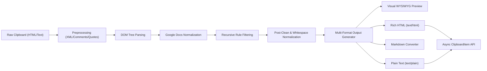

# Architecture & Technical Design: PasteMagic

## 1. System Overview

PasteMagic is a client-side web application designed to solve the problem of clipboard style contamination. When users copy rich text from the web, Microsoft Word, or Google Docs, the clipboard contains arbitrary nested styling rules, fonts, inline colors, and tracking tags. Traditional plain-text editors (like Notepad) strip everything—including desirable semantic structures (bold, italics, lists, headings, tables, links).

PasteMagic provides a configurable, AST-like DOM traversal pipeline that allows users to surgically select which elements and styles to preserve and which to eliminate.

---

## 2. Component Structure

- **`src/types.ts`**:
  - `FilterOptions`: Comprehensive interface for all granular sanitization flags (emphasis, structure, lists, tables, links, CSS, whitespace).
  - `SanitizerStats`: Telemetry metrics tracking characters saved, rules stripped, tracking tags removed, and tag inventory.
  - `SanitizerResult`: Encapsulates `cleanHtml`, `cleanText`, `cleanMarkdown`, and `stats`.

- **`src/utils/sanitizer.ts`**:
  - Core engine of the application.
  - Leverages browser-native `DOMParser` for safe parsing without executing scripts or styles.
  - Recursively inspects nodes, handles tag unwrapping, attribute removal, style rule parsing, and URL parameter filtering.

- **`src/utils/toMarkdown.ts`**:
  - Zero-dependency DOM to Markdown transformer.
  - Supports headings (`#` to `######`), emphasis (`**bold**`, `*italic*`, `~~strike~~`), lists (`-` and `1.`), blockquotes (`>`), code blocks, horizontal rules, and Markdown tables.

- **`src/utils/clipboard.ts`**:
  - Handles writing multi-MIME clipboard payloads (`text/html` and `text/plain` simultaneously via `new ClipboardItem()`).
  - Implements fallback copy via temporary DOM elements for legacy browser compatibility.
  - Provides `readClipboard()` for direct clipboard inspection when permitted.

- **`src/utils/presets.ts`**:
  - Curated configurations tailored for specific workflows: `Doc Ready`, `Pure Semantic`, `Minimal Notes`, `Text + Links`, and `Sanitized Plain`.

- **`src/utils/samples.ts`**:
  - Real-world test data reproducing Word documents, Google Docs, blog posts with UTM tracking, and styled tables.

- **`src/components/`**:
  - `Navbar`: Brand, privacy pill, dark mode toggle, keyboard shortcut launcher, history drawer toggle.
  - `PresetsBar`: Instant one-click preset selector and custom rules drawer toggle.
  - `FilterControls`: Categorized toggles and switches with live preview updating.
  - `InputPane`: Paste target area, manual paste button, sample selector, clear action, and input stats.
  - `OutputPane`: Multi-tab view (WYSIWYG preview, Markdown, HTML, Plain text), primary "Copy Formatted" action, confetti animation, and reduction stats ribbon.
  - `StatsModal`: Diagnostic modal displaying removed CSS rules, stripped tracking parameters, and tag inventory.
  - `HistoryDrawer`: Persistent recent pastes saved to `localStorage`.
  - `ShortcutsModal`: Hotkey cheat sheet.
  - `Toast`: Transient feedback notification system.

---

## 3. Data Flow & Security Guarantees

1. **100% Client-Side Execution**: All transformations occur inside the user's browser sandbox. No input or clipboard data is ever sent to an external server or API.
2. **XSS Prevention**:
   - `<script>`, `<style>`, `<link>`, and `<meta>` tags are stripped during preprocessing.
   - All inline event attributes (`onclick`, `onload`, `onerror`, etc.) are stripped from all elements.
   - Dangerous URL schemes (`javascript:`, `vbscript:`, `data:`) on anchor tags are neutralized.
3. **Reactive Re-Sanitization**:
   - React's `useMemo` dynamically re-computes the cleaned output whenever the user pastes new content or toggles any filter rule, providing instant 0ms latency visual feedback.
